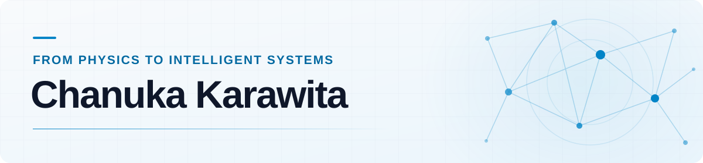

<picture>
  <source media="(prefers-color-scheme: dark)" srcset="assets/profile-dark.svg">
  
</picture>

# Chanuka Karawita

**AI Engineer · Agentic AI · Computer Vision** 
Colombo, Sri Lanka

I’m an AI engineer with a background in computational physics, building agentic AI workflows, computer vision applications, and cloud-based machine learning systems.

[Email](mailto:cu9428@gmail.com) · [LinkedIn](https://linkedin.com/in/chanuka-karawita-105319111) · [Research](https://scholar.google.com/citations?user=OCmU8DwAAAAJ&hl=en)

## What I build

- **Agentic AI systems:** Conversational agents and multi-agent workflows, with custom MCP integrations and deployment on AWS.
- **Computer vision applications:** Real-time video analytics, image processing, and visual recognition systems.
- **Machine learning solutions:** Contrastive learning, visual representation learning, and controllable image generation.
- **AI-powered backends:** APIs and document-processing services that connect models, data, and cloud infrastructure.

## Research

**[Exploring Emergent Topological Properties in Socio-Economic Networks through Learning Heterogeneity](https://link.springer.com/article/10.1007/s13278-025-01512-0)** 
*Social Network Analysis and Mining* · 16, Article 16 (2026) · [Preprint](https://arxiv.org/abs/2510.24107)

**[Machine-learning-assisted Classification of Thermodynamic Phases in the Classical Heisenberg Antiferromagnet on a Triangular Lattice](https://science.cmb.ac.lk/icmas2021/wp-content/uploads/2021/12/Conference-Proceedings-ICMAS-2021.pdf)** 
Conference abstract · ICMAS 2021

## Education

**BSc (Special) in Computational Physics** · University of Colombo

## Toolkit

**Languages**

  &ensp;
  &ensp;
  &ensp;
  &ensp;
  &ensp;

Python · C++ · Go · JavaScript · MATLAB

**Agents & NLP**

  &ensp;
  &ensp;
  &ensp;
  &ensp;
  &ensp;
  &ensp;

LangChain · LangGraph · LangSmith · CrewAI · MCP · spaCy

**ML & computer vision**

  &ensp;
  &ensp;
  &ensp;
  &ensp;
  &ensp;
  &ensp;

PyTorch · TensorFlow · Keras · scikit-learn · OpenCV · YOLO

**Scientific computing**

  &ensp;
  &ensp;
  &ensp;
  &ensp;
  &ensp;
  &ensp;

NumPy · SciPy · pandas · NetworkX · Optuna · Matplotlib

**Applications & data**

  &ensp;
  &ensp;
  &ensp;
  &ensp;

FastAPI · MongoDB · MySQL · ClickHouse

**Infrastructure & tooling**

  &ensp;
  &ensp;
  &ensp;
  &ensp;
  &ensp;
  &ensp;

AWS · Docker · Terraform · Git · Linux · Bash

  &ensp;

DVC

**AWS services**

<table>
  <tr>
    <td align="center"> Bedrock AgentCore</td>
    <td align="center"> SageMaker</td>
  </tr>
  <tr>
    <td align="center"> Lambda</td>
    <td align="center"> EC2</td>
  </tr>
  <tr>
    <td align="center"> S3</td>
    <td align="center"> DynamoDB</td>
  </tr>
  <tr>
    <td align="center"> Textract</td>
    <td align="center"> API Gateway</td>
  </tr>
  <tr>
    <td align="center"> RDS</td>
    <td align="center"> Batch</td>
  </tr>
  <tr>
    <td align="center"> App Runner</td>
    <td></td>
  </tr>
</table>

Detailed toolkit and AWS experience

### AWS & cloud deployment

- **Agentic AI:** Amazon Bedrock AgentCore for deploying agentic applications.
- **Model training:** Amazon SageMaker.
- **Compute & deployment:** AWS Batch, App Runner, Lambda, and Amazon EC2.
- **Containers & infrastructure as code:** Docker and Terraform.
- **Storage, APIs & databases:** Amazon S3, API Gateway, Amazon DynamoDB, and RDS.
- **Document intelligence:** Amazon Textract for text and layout extraction from scanned documents.

### AI & scientific computing

- **Agent systems:** LangChain, LangGraph, LangSmith, CrewAI, and MCP servers for internal data sources.
- **Deep learning & vision:** PyTorch, TensorFlow, Keras, OpenCV, NVIDIA DeepStream, YOLO, CNNs, and vision transformers.
- **Data & modelling:** NumPy, SciPy, pandas, scikit-learn, statsmodels, NetworkX, and Optuna.
- **Visualisation:** Matplotlib and Seaborn.
- **Speech & NLP:** spaCy, NLTK, and hidden Markov models.

### Software & ML tooling

- **Languages:** Python, C++, Go, JavaScript, MATLAB, and SQL.
- **Applications & databases:** FastAPI, MongoDB, and MySQL.
- **Data warehouse & analytics:** ClickHouse.
- **Development & reproducibility:** Git, Linux, Bash scripting, and DVC for dataset versioning and reproducible ML pipelines.

---

Interested in agentic AI, computer vision, or computational research? [Let's connect on LinkedIn](https://linkedin.com/in/chanuka-karawita-105319111) or [send me an email](mailto:cu9428@gmail.com).
